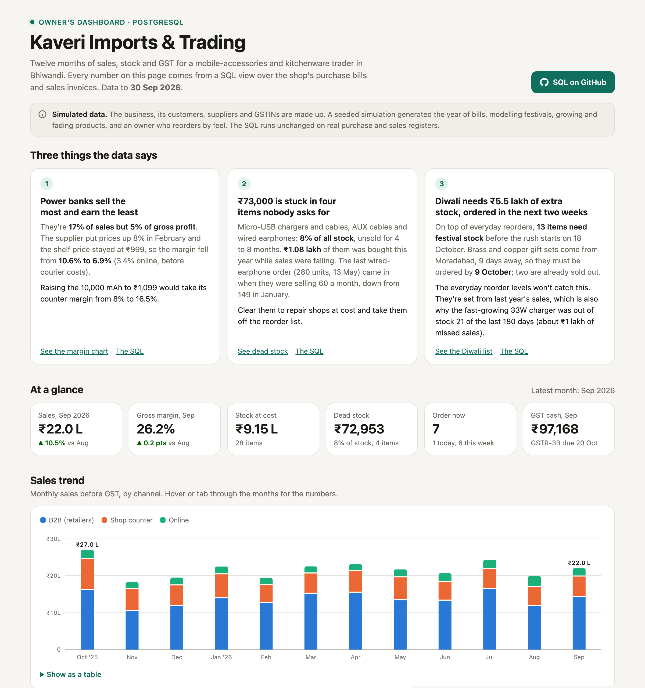
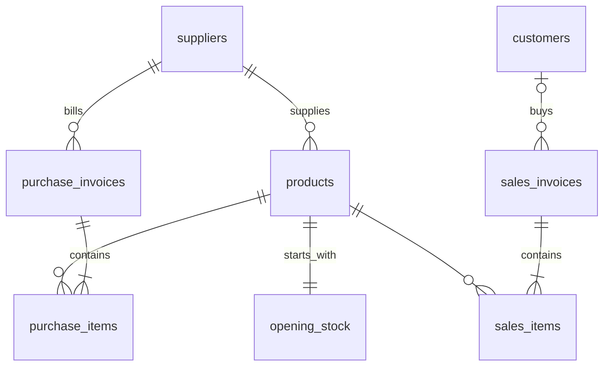

# Shop Owner Dashboard: SQL + PostgreSQL

**[Live dashboard](https://yashguptayg9013.github.io/shop-dashboard/)** · **[Looker Studio version](https://lookerstudio.google.com/reporting/af1a9c31-0a81-47e9-befe-b813f2ecc85f)** · PostgreSQL 17 · SQL views



A trader's year of purchase bills and sales invoices goes into PostgreSQL. SQL views turn it into what an owner checks each morning: how sales are trending, what to reorder, what's stuck on the shelf, what the next festival needs, and the GST due this month.

The business, Kaveri Imports & Trading in Bhiwandi, is made up. It's the buyer on the sample bills in [Bill Reader](https://github.com/yashguptayg9013/bill-reader), the app that reads supplier bills with Claude, so this is where those bills end up. A seeded simulation ([`scripts/generate_data.py`](scripts/generate_data.py)) generated its year of trading: 15,062 sales invoices, 25,176 sales lines and 180 purchase bills. The SQL doesn't know or care that the data is simulated.

## Three things the data says

Each finding comes from a query in [`sql/insights/`](sql/insights/), run against the views.

**1. Power banks sell the most and earn the least.** They're 17% of sales but 5% of gross profit. The supplier put prices up 8% in February while the shelf price stayed at ₹999, so the margin fell from 10.6% to 6.9% (3.4% online, before courier costs). Raising the 10,000 mAh to ₹1,099 would take its counter margin from 8.2% to 16.5%. → [`1_power_bank_margin.sql`](sql/insights/1_power_bank_margin.sql)

**2. ₹73,000 is stuck in four items nobody asks for.** Micro-USB chargers and cables, AUX cables and wired earphones are 8% of all stock and have gone unsold for 118 to 258 days. ₹1.08 lakh of them was bought in 2026 while sales were already falling. The last wired-earphone order (280 units, 13 May) came in when they were selling 60 a month, down from 149 in January. Clear them to repair shops at cost and take them off the reorder list. → [`2_dead_stock.sql`](sql/insights/2_dead_stock.sql)

**3. Diwali needs ₹5.5 lakh of extra stock, ordered in the next two weeks.** On top of everyday reorders, 13 items need festival stock before the rush starts on 18 October. Brass and copper gift sets come from Moradabad, 9 days away, so they must be ordered by 9 October, and two are already sold out. The everyday reorder levels won't catch this. They're set from last year's sales, which is also why the fast-growing 33W charger was out of stock 21 of the last 180 days (about ₹1 lakh of missed sales). → [`3_diwali_prep.sql`](sql/insights/3_diwali_prep.sql)

## What's in the SQL

| File | Answers | SQL worth a look |
|---|---|---|
| [`01_schema.sql`](sql/01_schema.sql) | 10 tables: bills, lines, products, suppliers, customers, festivals | Keys, `check` constraints, an `as_of()` function |
| [`10_sales_lines.sql`](sql/views/10_sales_lines.sql) | What did each sale cost us? | Price history with `lead()` validity ranges, `distinct on`, a range join |
| [`11_monthly_sales.sql`](sql/views/11_monthly_sales.sql) | Monthly sales, margin and channel mix | `filter (where …)` aggregates, `lag()` for month-on-month change |
| [`12_product_performance.sql`](sql/views/12_product_performance.sql) | ABC analysis: which items make 80% of sales | Running totals with `sum() over (order by …)`, `rank()` |
| [`13_seasonality.sql`](sql/views/13_seasonality.sql) | Which items are festival items? | Observed vs expected sales in each festival window, per festival |
| [`20_stock.sql`](sql/views/20_stock.sql) | Stock on hand, every day, worked out from the bills | `generate_series` calendar, cumulative `sum() over (partition by …)` |
| [`21_dead_stock.sql`](sql/views/21_dead_stock.sql) | Dead, slow and seasonal stock | |
| [`22_reorder.sql`](sql/views/22_reorder.sql) | What to order today, and missed sales from stockouts | Pace over in-stock days only, rounding up to pack size |
| [`23_festival_prep.sql`](sql/views/23_festival_prep.sql) | Extra stock for the next festival, and the order-by date | Chained CTEs, comparing with the same festival last year |
| [`30_gst.sql`](sql/views/30_gst.sql) | Monthly GSTR-3B summary and HSN summary | **Recursive CTE** carrying unused credit month to month |
| [`90_data_checks.sql`](sql/views/90_data_checks.sql) | Can the numbers be trusted? | GSTIN check-digit validation in pure SQL, invoice-number gap check |

Stock is never stored. It's always opening stock plus purchases minus sales, so it can't drift from the bills.

### Data model



`business` (one row: name, GSTIN, home state) and `festivals` (dates and rush length) are small reference tables.

### Data checks

The build stops if any of these fail:

- Invoice and bill totals match their lines; GST on each invoice matches its lines
- Same-state bills charge CGST + SGST, other states IGST
- Grand total = taxable value + GST + round-off
- Invoice numbers run 1, 2, 3… with no gaps in each financial year (GST requires consecutive numbering)
- Stock never goes below zero
- Every GSTIN has a valid format and check character
- Every sale has a cost price

## Run it

You need PostgreSQL 14 or newer and Python 3 (standard library only).

```bash
brew install postgresql@17 && brew services start postgresql@17
createdb shop
DATABASE_URL=postgresql://localhost/shop ./scripts/build.sh
```

`build.sh` regenerates the data, creates the tables, loads the CSVs, creates the views, runs the data checks and exports the dashboard data. It takes about a second. Then serve the dashboard:

```bash
python3 -m http.server 4100 --directory docs
```

Open http://localhost:4100. To explore in `psql`:

```bash
psql shop -c "select * from shop.v_reorder_alerts where status <> '4 OK'"
```

### Use real data

Replace the CSVs in `data/` with exports from your own registers, keeping the column names (see `sql/01_schema.sql`), set your business row and festival dates in the schema, then run `./scripts/build.sh --keep-data`. If the data checks fail, they'll tell you what to fix.

## Looker Studio

**[Open the Looker Studio report](https://lookerstudio.google.com/reporting/af1a9c31-0a81-47e9-befe-b813f2ecc85f)** (Looker Studio is now called Data Studio). It has three pages: sales and margin (scorecards, monthly sales by channel, margin by category), stock and Diwali (reorder alerts, dead stock, the Diwali buy list) and GST (monthly output tax, input credit and cash payable).

It reads the CSVs in `looker-studio/`, which are the output of the PostgreSQL views, plus `sales_lines.csv` (one row per sale line) for Looker Studio's own filters and date range. [`looker-studio/README.md`](looker-studio/README.md) explains how it was built and how to refresh it.

## Assumptions and limits

- **Cost** is the latest supplier bill's rate on the sale date. Small traders usually think about cost this way, and it shows a supplier price rise in the month it lands. Weighted-average cost would smooth it.
- **GST:** CGST, SGST and IGST credit are pooled when carrying credit forward. The real set-off order can move money between heads, so the summary is an estimate for the CA, not a filing. The data starts 1 October 2025, so September's credit on the Diwali stock isn't in it, which makes October's cash payable look high.
- **Missed sales** from stockouts assume every customer who found the shelf empty walked away, so treat them as the upper end.
- **Festival prep** forecasts this year's rush from this year's pace and last year's uplift. With one year of data there's only one Diwali to learn from.
- GST rates follow the September 2025 changes (5% for kitchenware, 18% for electronics). All names and GSTINs are made up.
